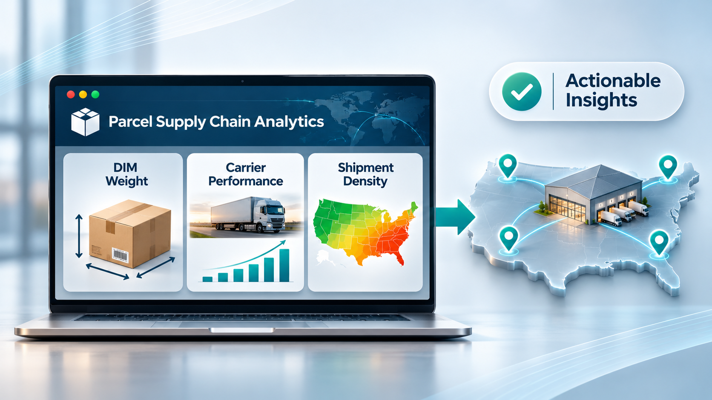

# Supply Chain Leadership × Applied Data Science

### Ramon Cholico | Global Supply Chain Executive & Data Science Specialist

A professional portfolio connecting **20+ years of global supply chain leadership** with applied analytics, machine learning, transportation network design, and data-driven business decisions.

**[🌐 Explore the Live Portfolio](https://rcholico.github.io/)** · **[GitHub Profile](https://github.com/rcholico)** · **[LinkedIn](https://www.linkedin.com/in/ramon-cholico)**

---

## Portfolio at a Glance

| 20+ Years | $88M+ | 9 Case Studies | AI & ML |
|:--|:--|:--|:--|
| Global supply chain leadership | Logistics spend managed | Applied business and analytics projects | Data-driven optimization |

The website showcases practical business problems, analytical approaches, and decision-ready findings across freight procurement, parcel analytics, distribution network design, and transportation strategy.

## Featured Project Visual

[](https://rcholico.github.io/#projects)

*Explore all nine illustrated case studies on the [live portfolio](https://rcholico.github.io/#projects).*

## Case Studies

### Transportation & Network Optimization

| Project | Focus | Key finding / scope |
|:--|:--|:--|
| [US–Canada Direct Parcel Injection](https://github.com/rcholico/US-Canada-CrossBorder-Purolator-Injection) | Cross-border sourcing and linehaul injection | 19.7% lower cost per shipment in the evaluated routing comparison |
| [DC Location Optimization](https://github.com/rcholico/DC-Relocation) | K-Means clustering and distribution network redesign | 378K+ shipment records analyzed; evaluated Wisconsin-to-Missouri relocation |
| [US Zone Skipping & Air-Bulk Injection](https://github.com/rcholico/US-Zone-Skipping-Air-Bulk-Optimization) | Alternative parcel injection strategies | Modeled Northeast transit-time improvement to 4–6 days |
| [Multimodal Transportation Analysis](https://github.com/rcholico/International-Freight-Network-Analysis) | Ocean vs. intermodal rail trade-offs | Up to 21 days of modeled lead-time improvement |

### Freight Cost Analytics & Strategic Sourcing

| Project | Focus | Key finding / scope |
|:--|:--|:--|
| [Orthopedic Implants Freight Optimization](https://github.com/rcholico/Orthopedic-Implants-Freight-Spend-Optimization) | Express-to-Ground and service-level optimization | **$1.36M projected annualized savings** |
| [Global Forwarder Sourcing RFQ](https://github.com/rcholico/Global-Freight-Forwarder-Procurement-RFQ) | Freight-forwarder bid comparison across 826 containers | **$8.43M modeled savings opportunity (65% vs. baseline)** |
| [Fuel Surcharge Sensitivity Model](https://github.com/rcholico/Geopolitical-Risk-Fuel-Sensitivity-Model) | Freight cost sensitivity to diesel price shocks | **$271K+ modeled fuel surcharge exposure** |

### Data Analytics & Governance

| Project | Focus | Key finding / scope |
|:--|:--|:--|
| [Parcel Supply Chain Analytics](https://github.com/rcholico/Parcel-SupplyChain-Analytics) | Python-driven carrier analysis | Dimensional-weight billing, service performance, shipment density and zone structures |
| [Global Freight Auditor Selection](https://github.com/rcholico/Freight-Auditor-Selection) | Vendor assessment, financial fit and data governance | Evaluation of freight audit solutions for approximately $23M in EMEA freight spend |

> **Metric interpretation:** Project figures may represent modeled scenarios, evaluated comparisons, or proposed opportunities rather than implemented or realized financial results. Follow the individual repositories for assumptions and methodology.

## Website Features

- **Responsive design:** light-themed layout optimized for desktop and mobile viewing.
- **Interactive project filters:** browse Transportation, Cost Optimization, Network Design, and Analytics.
- **Quick View dialogs:** review a concise project summary before opening its repository.
- **Project illustrations:** visual summaries of the problem, analytical approach, and outcome.
- **Professional introduction:** executive background, skill areas, and contact links.

## Website Technology

| Technology | Use |
|:--|:--|
| HTML5 | Page structure and accessible content |
| CSS3 | Responsive layout, typography, project cards, and visual styling |
| Vanilla JavaScript | Project filters, Quick View dialogs, and dynamic footer year |
| Font Awesome | Interface and navigation icons |
| GitHub Pages | Static website hosting |

This is a **static website**; it does not require a backend, build pipeline, or package installation to view locally.

## Repository Structure

```text
rcholico.github.io/
├── index.html           # Main portfolio website
├── images/              # Case-study illustrations
│   ├── Parcel-Analytics.png
│   ├── DC-Reloc.png
│   └── ...
├── README.md            # Repository overview
├── _config.yml          # GitHub Pages configuration
└── .nojekyll            # Disable Jekyll processing
```

## Run Locally & Publish

1. Clone this repository or download its files.
2. Open `index.html` in a modern web browser.
3. Keep the `images/` folder beside `index.html` so the project illustrations load correctly.
4. To publish updates, commit changes to the `main` branch; GitHub Pages serves the website at **https://rcholico.github.io/**.

When adding a project, update its card in `index.html`, link its repository, include an image in `images/`, and adjust the case-study count if needed.

## About Me

I bring over two decades of global supply chain experience to practical problems in logistics analytics, freight sourcing, transportation optimization, and machine learning. I am pursuing an **M.S. in Engineering Management & Leadership (Data Science Focus)** at **Rice University**, where I also serve as a graduate teaching assistant.

My academic background also includes a **OneMBA Global Executive MBA** from **EGADE Business School, Tec de Monterrey**, and a **B.S. in Industrial & Systems Engineering** from **Tec de Monterrey**.

## Connect

- **Portfolio:** https://rcholico.github.io/
- **GitHub:** https://github.com/rcholico
- **LinkedIn:** https://www.linkedin.com/in/ramon-cholico
- **Email:** rcholico@hotmail.com

---

*Built to demonstrate how executive supply chain experience and applied data science can inform better operational decisions.*
